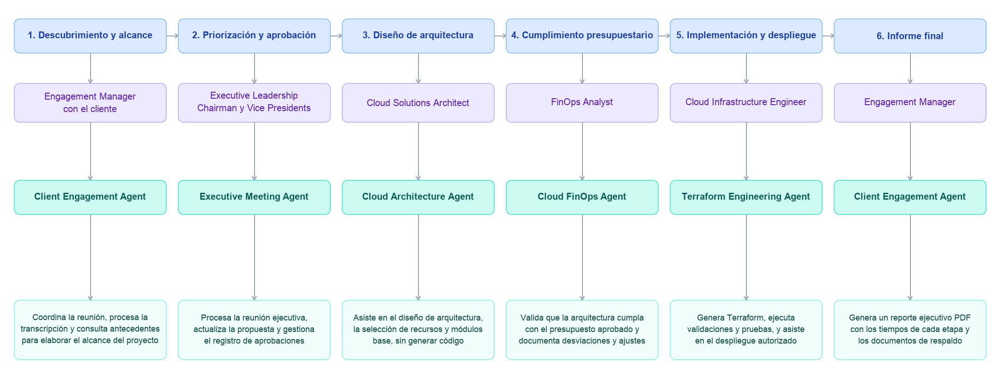

# Consultoría de arquitectura AWS

Nueva iteración del proyecto para el curso **PSWE-07 Procesos y Administración de Software**. Este documento presenta el proceso actual de la consultora, un video del caso ilustrativo y la propuesta de transformación con agentes de inteligencia artificial.

Repositorio original: [marcor0311/aws-cloud-consultant-agent](https://github.com/marcor0311/aws-cloud-consultant-agent).

## 1. Proceso actual: del cliente al informe ejecutivo

El trabajo pasa por seis etapas, con una persona responsable y una entrega que permite continuar a la siguiente.

1. **Descubrimiento y alcance — Engagement Manager.** Recibe la solicitud del cliente, comparte su agenda y confirma la reunión o coordina su reprogramación. En la reunión recoge necesidades, presupuesto, plazos y requisitos de servicio, seguridad y datos. Organiza las notas, consulta proyectos anteriores y prepara la propuesta para la dirección ejecutiva.
2. **Priorización y aprobación — Dirección ejecutiva.** Revisa el valor y la prioridad del proyecto, aclara el alcance y define el presupuesto de nube. Si necesita más información, devuelve la propuesta al Engagement Manager; cuando aprueba avanzar, entrega los insumos al arquitecto.
3. **Diseño de arquitectura — Cloud Solutions Architect.** Define el diagrama AWS, los recursos, los módulos de línea base y los supuestos de uso. Realiza una estimación inicial y entrega la propuesta a FinOps. Su responsabilidad es el diseño; la programación de Terraform corresponde a ingeniería.
4. **Cumplimiento presupuestario — FinOps Analyst.** Contrasta los recursos y supuestos con AWS Pricing Calculator y valida que el costo estimado cumpla con el presupuesto aprobado. Documenta la revisión y aprueba los costos o solicita ajustes al arquitecto. Si cumplir exige cambiar el alcance o el presupuesto, la decisión vuelve a la dirección ejecutiva.
5. **Implementación y validación local — Cloud Infrastructure Engineer.** Desarrolla Terraform con los módulos seleccionados, revisa el código y ejecuta pruebas de configuración, seguridad y cumplimiento de la arquitectura. Valida el despliegue en el entorno local de pruebas, conserva evidencias y prepara el plan de despliegue. Entrega el proyecto y los resultados al Engagement Manager.
6. **Informe final — Engagement Manager.** Reúne los tiempos de cada etapa y entre entregas, junto con los documentos de respaldo, y prepara un informe ejecutivo en PDF para la dirección.

**Resultado:** infraestructura como código validada localmente y preparada para desplegarse. El despliegue en una cuenta AWS real requiere la autorización correspondiente; el mantenimiento y los cambios posteriores pertenecen a otro flujo.

## 2. Video del proceso actual

El caso ilustrativo recorre el trabajo de Stuart, Andrés, Camila y Diego para BMW Canadá: desde la solicitud inicial hasta el informe ejecutivo. FinOps contrasta una estimación de **USD 9.500 mensuales** con un presupuesto aprobado de **USD 10.000**. Son cifras del ejemplo, no una cotización real.

<video src="consultora-60s_2026-10-26_11-37-08.mp4" controls></video>

## 3. Transformación propuesta con agentes de IA

La propuesta incorpora un agente de apoyo en cada etapa y conserva la revisión y las decisiones de las personas responsables. Cada entrega al siguiente equipo comparte el contexto del proyecto, los documentos y las aprobaciones, evitando volver a recopilar la misma información.

El diagrama se lee de izquierda a derecha. En cada columna aparecen, de arriba abajo: **proceso → puesto → agente → funcionalidad**. El mismo **Client Engagement Agent** apoya al Engagement Manager tanto en el descubrimiento como en el informe final.

[Ver o editar el diagrama Mermaid (.mmd)](docs/process-flow.mmd)

Los ciclos de aclaraciones y ajustes descritos en el proceso actual también aplican a la propuesta. Los nombres y capacidades del diagrama representan el flujo objetivo con agentes; su presencia aquí no acredita que todas las integraciones estén implementadas.
