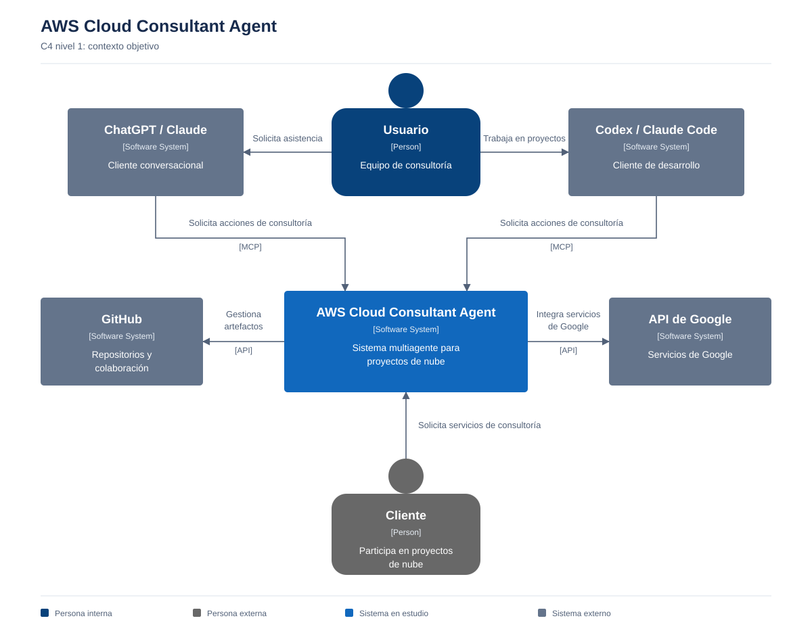
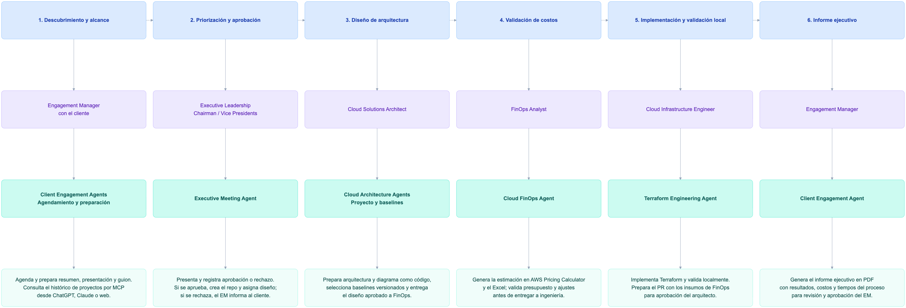
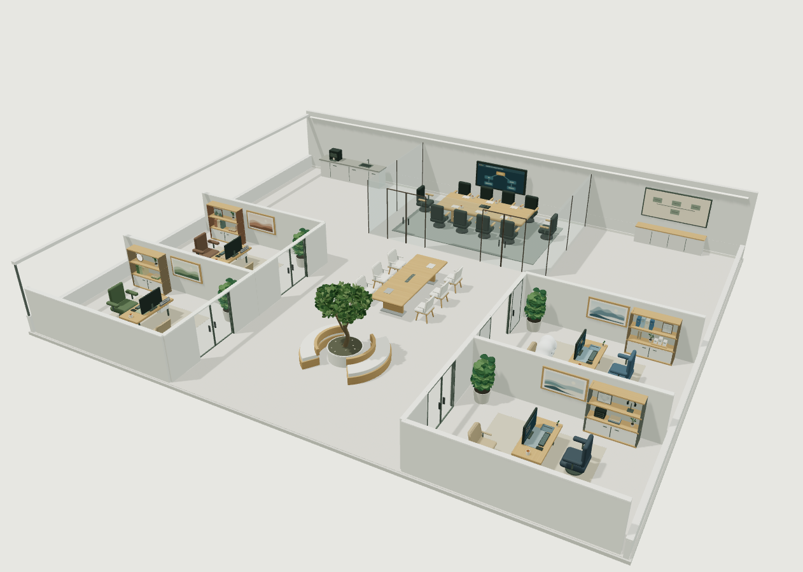

# Consultoría de arquitectura AWS

AWS Cloud Consultant Agent es un sistema multiagente en desarrollo para apoyar
los puestos de una consultora en proyectos de nube. Los agentes utilizan
herramientas, ejecutan tareas y coordinan entregas entre negocio, arquitectura,
FinOps e ingeniería, desde la solicitud del cliente hasta el informe y cierre
de la fase de consultoría. Las personas revisan y aprueban los resultados.

El equipo consume las herramientas del sistema mediante MCP desde
ChatGPT/Claude y Codex/Claude Code. La agenda y el correo se integran mediante
las API de Google Calendar y Gmail.

> **Segunda iteración del proyecto**
>
> El repositorio original,
> [Proyecto-Multiagentes-Tendencias-en-Ingenieria-del-Software](https://github.com/marcor0311/Proyecto-Multiagentes-Tendencias-en-Ingenieria-del-Software),
> se desarrolló para el curso
> **PSWE-01 Tendencias en Ingeniería del Software**.
>
> Esta segunda iteración corresponde al curso
> **PSWE-07 Procesos y Administración de Software**.

## Repositorios relacionados

Los repositorios de cada proyecto se crean y se trabajan dentro de la organización
[aws-cloud-consulting-group](https://github.com/aws-cloud-consulting-group).

El proyecto utiliza estos repositorios como insumos para el diseño y la
organización de los proyectos de consultoría:

| Repositorio | Propósito |
| --- | --- |
| [aws-cloud-consultant-baseline-modules](https://github.com/marcor0311/aws-cloud-consultant-baseline-modules) | Catálogo de módulos Terraform versionados para diseñar e implementar las arquitecturas AWS. |
| [aws-cloud-consulting-project-template](https://github.com/marcor0311/aws-cloud-consulting-project-template) | Estructura inicial para crear un repositorio independiente por proyecto, con sus áreas numeradas. |

## Contexto del sistema

## 1. Proceso actual: del cliente al informe ejecutivo

El video muestra un proceso manual: cada persona prepara su parte y entrega
los insumos a la siguiente. La coordinación de reuniones, el traslado de
información y la recopilación de resultados dependen del equipo.

1. **Descubrimiento (Engagement Manager).** El cliente escribe por correo; el responsable comparte su agenda y confirma la reunión. Después recoge las necesidades, el presupuesto y los plazos, organiza sus notas y revisa proyectos anteriores para preparar la propuesta.

2. **Priorización (Executive Leadership).** El Engagement Manager presenta la propuesta y la dirección evalúa si continuar. Si la aprueba, prioriza el proyecto, autoriza el presupuesto de nube y pasa los insumos al arquitecto. Si la descarta, el proceso termina y el Engagement Manager informa al cliente que no se continuará con el proyecto.

3. **Diseño (Cloud Solutions Architect).** El arquitecto dibuja la solución AWS, selecciona los módulos de línea base y prepara una primera estimación. Entrega el diagrama, los recursos y los supuestos de uso a FinOps.

4. **Costos (FinOps Analyst).** Estima los costos de los recursos en AWS Pricing Calculator y prepara un Excel con el desglose, las proyecciones y los escenarios de costos. Contrasta ambos insumos con el presupuesto aprobado y entrega la estimación de la calculadora y el Excel validados a ingeniería.

5. **Implementación (Cloud Infrastructure Engineer).** Programa Terraform, revisa el código y ejecuta pruebas de configuración, seguridad y cumplimiento del diseño. Realiza el despliegue local, guarda las evidencias y prepara el plan de despliegue.

6. **Informe (Engagement Manager).** Recibe el proyecto y los resultados de ingeniería, reúne los documentos y los tiempos de cada etapa y entre entregas. Prepara el informe ejecutivo y lo presenta a dirección.

> **Resultado:** infraestructura validada localmente y preparada para desplegarse; el equipo de desarrollo puede continuar con la aplicación.

## 2. Video del proceso actual

https://github.com/user-attachments/assets/7f10b3d4-1c70-4ffb-8118-c16bec2319a3

## 3. Transformación propuesta con agentes de IA

La propuesta se define en [los issues de agentes](issues.md): incorpora apoyo de IA en cada etapa y conserva la revisión y las decisiones de las personas responsables. Cada entrega al siguiente equipo comparte el contexto del proyecto, los documentos y las aprobaciones, evitando volver a recopilar la misma información.

La reunión final del cliente con Stuart se prepara con el
[cuestionario de cierre del proyecto de nube](docs/cuestionario-stuart-nube.md).
Reúne 15 preguntas de negocio para una conversación de 30 minutos sobre
objetivos, alcance, presupuesto, pagos, fechas, demanda y expectativas de servicio.
Las respuestas sirven de insumo para Junta, Arquitectura, FinOps e Ingeniería.

El diagrama se lee de izquierda a derecha. Cada columna muestra **proceso → puesto → agente → funcionalidad**. El agendamiento y la preparación usan agentes separados, al igual que el proyecto y los baselines. EM se refiere al Engagement Manager.

La consulta del histórico de proyectos por MCP ya está desarrollada y se utiliza desde ChatGPT, Claude o web. Los issues detallan las responsabilidades, herramientas y entregas de la propuesta, e indican las funcionalidades pendientes.

## 4. Oficina virtual

El dashboard permite identificar la etapa del flujo de trabajo en la que se encuentra el agente y el equipo con el que colabora para ese proyecto.

## Credenciales locales

Guardar credenciales fuera del repositorio en `~/.config/aws-cloud-consultant-agent/dev/`.
`project/.env` conserva solo configuración no sensible y la ruta a ese directorio.
La [estructura de ejemplo](config/local-secrets.example/README.md) describe los archivos
privados, la migración con respaldo y el contrato de producción. Los ejemplos se
versionan con valores vacíos; los tokens y sesiones reales nunca se suben.
