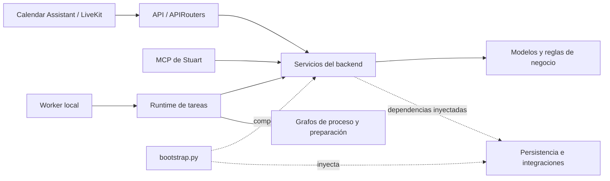

# Arquitectura local del proyecto

El repositorio contiene el backend, el agente de voz y la interfaz. La organización
distingue el código implementado de las carpetas documentales de agentes pendientes.
Las seis etapas son estados del proceso y su número no determina los runtimes. Los datos conservan sus rutas originales; las credenciales locales se centralizan fuera del repositorio.

## Estructura de project/

```text
project/
├── backend/
│   ├── app/
│   │   ├── main.py             # Aplicación HTTP
│   │   ├── bootstrap.py        # Composición de servicios y adaptadores
│   │   ├── worker.py           # Entrada y bucle del único worker local
│   │   ├── mcp_server.py       # Herramientas MCP sobre los servicios
│   │   ├── api/                # APIRouters y dependencias HTTP
│   │   ├── clients/            # Dominio, registro y repositorio de clientes
│   │   ├── verification/       # Servicio OTP, contratos, schemas y repositorio
│   │   ├── notifications/      # Correo OTP, adaptadores y plantilla
│   │   ├── workflow/           # Grafo principal, reglas, servicio y runtime
│   │   ├── preparation/        # Grafo de preparación, estado, nodos y servicio
│   │   ├── project_opening/    # Agente 2: apertura aprobada, cola y entrega
│   │   ├── persistence/        # SQL del proceso, checkpoints y exclusión local
│   │   ├── integrations/       # Google, Slack, IA y proveedores ficticios
│   │   ├── core/               # Rutas y validación común
│   │   ├── cli/                # Comandos administrativos y lanzadores de demos
│   │   └── demos/              # Recorrido ficticio y UI de la demo OAuth
│   ├── fixtures/               # Datos ficticios versionados
│   └── tests/                  # Pruebas agrupadas por responsabilidad
├── agents/
│   ├── 1. calendar assistant/
│   │   ├── src/                # Entrada, reglas, adaptadores y herramientas de voz
│   │   ├── prompts/
│   │   ├── demos/              # Runner de voz con modelo y transporte ficticios
│   │   ├── tests/
│   │   └── agent.json
│   ├── 2. meeting assistant/    # Entrada, instrucciones y plantilla de apertura
│   ├── 3. architecture agent/   # Responsabilidad documentada; runtime pendiente
│   ├── 4. finops agent/         # Responsabilidad documentada; runtime pendiente
│   ├── 5. terraform agent/      # Referencia al avance en backend/app/delivery
│   └── 6. project closure agent/ # Informe versionado y cierre condicionado
├── frontend/
│   ├── office-dashboard.html
│   ├── src/                    # JavaScript y CSS
│   ├── assets/                 # Recursos estáticos: SVG e imágenes
├── transcript-capture/         # Adaptación reproducible del capturador TranscripTonic
├── data/                       # Estado activo privado
├── generated/                  # Exportaciones y ejecuciones de demostración
└── .env                        # Configuración no sensible y ruta privada
```

Cada componente mantiene sus dependencias y pruebas. `docs/`, `references/`,
`scripts/`, `.github/`, `Makefile` e `issues.md` siguen en la raíz del repositorio.
Los entornos virtuales, caches y metadatos de instalación están ignorados en Git.

## Entradas y dependencias



Las reglas puras de clientes, agenda y transiciones del proceso no dependen de
FastAPI, MCP, LiveKit ni proveedores. Los servicios reciben sus colaboradores y
no construyen repositorios, clientes HTTP ni conexiones. Los servicios de proceso y preparación dependen de `workflow/ports.py`, que expone
estado, pausas y ejecución como datos y operaciones propios.
`integrations/langgraph.py` traduce ese contrato a `Command`, snapshots y
configuración de LangGraph. API y MCP traducen sus protocolos a llamadas a los servicios.

`bootstrap.py` es el lugar de composición: crea repositorios, proveedores y grafos,
conecta los eventos de preparación con el proceso principal y entrega el runtime.
No importa FastAPI. `api/dependencies.py` se ocupa de `Depends`, autenticación,
instancias HTTP y conversión de fallos a respuestas HTTP.

La preparación usa por defecto `integrations/ai/chatgpt_preparer.py` con la sesión
renovable Sign in with ChatGPT existente. Usa exclusivamente la transcripción y
las notas del proyecto como fuentes y envía ese contexto a Responses con OAuth,
`store=false` y `stream=true`; valida
el paquete y sus citas antes de persistirlo. `WORKFLOW_PREPARATION_PROVIDER=api`
selecciona explícitamente el adaptador anterior; nunca es un fallback automático.
La activación de inferencia continúa siendo expresa. El worker encola desde la
transcripción y recupera entradas anteriores sin preparación durante mantenimiento.
La recuperación incluye la pausa interactiva anterior `draft_with_chatgpt`:
encola una continuación del checkpoint y el servicio la reanuda únicamente cuando
el worker indica que existe un generador inyectado. Las pausas de revisión humana
no se reanudan por esta recuperación. Las tareas fallidas conservan el bloqueo
y requieren reintento explícito tras corregir su causa.

`mcp_server.py` ofrece STDIO y Streamable HTTP privado en localhost:8769/mcp.
Comparte el guard Bearer `integrations/mcp_http.py` con el MCP de apertura.
La herramienta de lectura `prepare` consulta cola, ejecución, bloqueos y documentos;
no inicia inferencia ni promete procesamiento cuando una tarea está fallida.
La skill del paquete local `plugins/aws-cloud-consultant/` define `/prepare` para
clientes compatibles y requiere enlace e instalación en la cuenta de ChatGPT.

El backend local expone `GET /health` mediante `api/health.py`. El adaptador
`integrations/health.py` revisa la configuración de verificación y renueva en
memoria las autorizaciones OAuth de Google para Calendar, Gmail y workflow.
Informa todos los resultados y su recuperación en una respuesta sin credenciales,
con estado HTTP 503 si hay un fallo requerido. Conserva una caché de hasta treinta
segundos invalidada por cambios de archivo. No compone runtimes, modifica estado,
envía correo ni ejecuta inferencia. El receptor público de Calendar no expone esta
ruta; `GET /` sigue siendo una comprobación básica sin llamadas externas.

| Módulo | Responsabilidad actual |
| --- | --- |
| `clients/domain.py` | Identidad, código permanente y contrato `ClientRegistry` |
| `clients/repository.py` | Registro específico de clientes en SQLite |
| `verification/service.py` | Reglas OTP, sesiones, límites y autorizaciones, sin SQL |
| `verification/ports.py` | Contratos transaccionales de sesiones y contadores |
| `verification/repository.py` | SQLite, schema existente, migración compatible y transacciones OTP |
| `notifications/` | Plantilla OTP y adaptadores Gmail/SMTP propios de esa función |
| `api/calendar_access.py` | Rutas existentes bajo `/api/calendar-access` |
| `api/meetings.py` | Registro de reunión con verificación vigente |
| `api/webhooks.py` | Validación de identidad/firma y adaptación de eventos Google/GitHub |
| `api/workflow.py` | Consultas y eventos autenticados del proceso |
| `mcp_server.py` | Las mismas herramientas MCP y schemas, delegando decisiones al servicio |
| `workflow/service.py` | Eventos, validación de avance, trabajo medido e historial |
| `workflow/runtime.py` | Despacho, recuperación y coordinación de tareas persistidas |
| `worker.py` | Bucle, polling y mantenimiento; ningún servidor lo inicia implícitamente |
| `persistence/workflow.py` | SQL compartido de tareas, versiones, entregas, eventos y tiempos |
| `persistence/checkpoints.py` | Ciclo de vida de savers SQLite/PostgreSQL |
| `persistence/locking.py` | Exclusión del worker y error de concurrencia |
| `workflow/ports.py` | Contrato compartido de ejecución y snapshots con datos simples |
| `integrations/langgraph.py` | Único adaptador de ejecución que conoce `Command` y snapshots de LangGraph |
| `integrations/` | Adaptadores concretos y errores de proveedores |

Los repositorios específicos existentes de clientes y adaptadores OTP siguen con
su módulo propietario. La persistencia del proceso completo ya no pertenece a
preparación. No se agregan interfaces ni repositorios por tabla sin un consumidor
real. Los servicios de negocio conservan sus límites de importación sin pruebas
que obliguen a reproducir la estructura de archivos. El repositorio OTP conserva
`BEGIN IMMEDIATE`, commits, rollback, schema y límites; retorna diccionarios, no filas SQLite.

## Grafos LangGraph

Se usa la librería directamente con el patrón documentado
[Custom workflow](https://docs.langchain.com/oss/python/langchain/multi-agent/custom-workflow).
FastAPI emplea los mecanismos de
[Bigger Applications](https://fastapi.tiangolo.com/tutorial/bigger-applications/):
`main.py`, módulos, `APIRouter` y dependencias. La organización de cada grafo sigue
[Application structure](https://docs.langchain.com/oss/python/langgraph/application-structure)
y agrupa construcción, estado y nodos. Estos frameworks permiten adaptar los
nombres y las carpetas; la estructura conjunta es una decisión del proyecto.

`workflow/graph.py` coordina seis etapas mediante `StateGraph`, edges condicionales
e `interrupt()`. `preparation/graph.py` construye el flujo posterior a la reunión;
`state.py` y `nodes.py` están junto al grafo. El modelo se recibe mediante
`DraftGenerator`; el repositorio y la búsqueda también son inyectados.

| Etapa | Condición de avance |
| --- | --- |
| 1. Engagement Manager | Transcripción recibida → cinco archivos corporativos → aprobación expresa del conjunto |
| 2. Dirección | Aprobación expresa; el rechazo termina el proceso |
| 3. Arquitectura | Entregable versionado y aprobación expresa |
| 4. FinOps | Aprobación → ingeniería; solicitud de cambios → arquitectura |
| 5. Ingeniería | Entregable versionado y aprobación expresa → informe |
| 6. Informe | Entregable versionado y aprobación expresa → cierre |

El proceso usa `process:<case_id>` y preparación usa `preparation:<case_id>`.
Son dos grafos con estados independientes enlazados por eventos; no se convierten
en un nuevo grafo anidado durante esta reorganización. Agent Server y
`langgraph.json` no forman parte de este modo de ejecución.

El procesador actual usa `ProcessedMeeting` (`preparation/processing.py`) y la
transcripción completa como única fuente documental. El proveedor redacta el resumen
y las diapositivas sin descubrimiento, preguntas nuevas, guion ni comparaciones.
`integrations/processed_documents.py` adapta ese contenido a `MeetingTranscript` y
`MeetingInsumos` y llama a `integrations/insumos_export.py`, el generador corporativo
vigente. Reutiliza ReportLab, Lato y la plantilla HTML; Chromium imprime las mismas
diapositivas a PDF sin red. Publica resumen de reunión, ficha de proyecto,
presentación HTML/PDF y transcripción íntegra PDF en `insumos/<case_id>/`.
No completa datos ausentes para satisfacer la plantilla. El servicio recibe el
publicador por inyección y notifica `awaiting_review` tras exportar los cinco.
`prepare` devuelve nombres/rutas, carpeta, revisión y estado, sin checkpoint completo.
Antes de aprobar se verifican los archivos; la aprobación del conjunto conduce al
handoff y persiste los mismos bytes para agente 2, sin paso de guion. La reexportación
local del contenido guardado crea una revisión pendiente sin nueva inferencia.
Los contratos y nodos anteriores se conservan para expedientes existentes de tres
archivos y de cuatro/cinco/seis archivos con Markdown y eventual guion. No se
reescriben manifiestos aprobados. `query`, las notas y la huella previa permanecen
para no invalidar checkpoints existentes.

Cada evento identifica etapa, iteración y versión. Se valida al encolar y al
aplicar. Una devolución incrementa la iteración e invalida aprobaciones antiguas.
El checkpoint permite recuperar sin repetir transiciones; documentos y avisos
mantienen sus claves de deduplicación. Un envío Slack incierto exige conciliación.

La apertura de la etapa 2 está implementada por Meeting Assistant. Las etapas
3–6 coordinan trabajo externo. Ingeniería automatiza la publicación e integración
de un commit ya probado mediante operaciones explícitas; Arquitectura y FinOps
siguen pendientes de sus runtimes propios.
Los webhooks aportan evidencia; un issue cerrado no aprueba etapas.
La recepción de ingeniería conserva un catálogo con revisión/hash de las corridas
importadas. La entrega técnica definitiva exige la aprobación exacta de etapa 5
y referencias externas confirmadas por el operador o contrastadas con la API de
GitHub. La publicación solicita revisión; la integración comprueba revisión,
baselines, CI y protección de rama, conserva recibos y encola el aviso en el
outbox de Slack existente. El informe captura esa entrega sin modificar fuentes
anteriores. Su presentación explícita aplica las transiciones de etapa 6 al
grafo principal y permite recuperar un cierre interrumpido entre checkpoint e
informe. El runtime de informes no compone proveedores de IA, GitHub o notificaciones.
El hash de un documento externo es declarado por el operador. La identidad viene
del MCP STDIO privado o del bearer HTTP configurado; el runtime sigue siendo de
un único operador, sin añadir autorización empresarial por puesto.

## Agente de voz

`project/agents/1. calendar assistant` mantiene su nombre, entrada `src/agent.py`,
identidad y modelos en `agent.json`, prompt y entorno `uv`.
`src/domain/` tiene las reglas de agenda y códigos; `src/integrations/` accede al
backend por HTTP y a Calendar; `src/tools/` conserva las herramientas MCP.
El backend no importa LiveKit y el agente no importa paquetes del backend.

El runner ficticio se ejecuta con `python -m demos.voice` desde la carpeta del
agente. Es una demostración con el SDK real y proveedores guionados, no una prueba
de comprensión del lenguaje por un modelo real. La preparación es otro agente
lógico implementado como grafo del backend y consta en el registro de agentes.
Las pruebas conservan los mocks y transcripts simulados. No hay escenarios ni
workflows de simulación cloud; las pruebas no hacen llamadas reales al agente.

Un resultado MCP respaldado por el backend con `not_registered` o `not_enabled`
cambia a una fase de derivación (`tools/advisor_transfer.py`) sin herramientas de
calendario ni datos del registro. Conserva la voz de Alisa, ofrece hablar con un
asesor y requiere aceptación explícita posterior a la oferta reproducida.
`integrations/sip_transfer.py` envía SIP REFER para el único participante SIP
remoto de la sala activa, con destino E.164 privado y espera acotada. Un fallo
conserva la conversación y ofrece contacto alternativo; no habilita el registro
ni autoriza citas. No se crean llamadas nuevas, trunks ni cuentas de proveedor.
Ver [configuración y límites](../project/agents/1.%20calendar%20assistant/README.md#transferencia-de-la-llamada-activa).

La sesión de voz conserva una referencia privada de la cita y entrega un recibo
firmado después de cerrar el audio. El backend persiste la entrega y el worker
procesa la cita sin depender de la sesión OTP ya cerrada. La validación incluye
cliente habilitado, firma del servicio y correlación con el evento de Calendar.
`workflow/calendar_sync.py` coordina canales `events.watch` y sincronización
incremental; `workflow/receipts.py` valida las entregas al cierre. Se reutilizan
las tablas de reuniones, eventos, tareas y checkpoints existentes. El worker no
consulta periódicamente Calendar en modo real. Ver
[configuración y límites de la integración](calendar-integration.md).

`calendar_webhook.py` es una entrada HTTP local exclusiva para el túnel de
desarrollo, en el puerto 8001. Reutiliza el handler de Calendar, la composición y
la persistencia del backend; solo publica el callback, sin documentación ni rutas
privadas. El backend completo permanece en localhost:8000.

`transcript-capture/prepare.py` construye una extensión local desde una versión
fijada y verificada de TranscripTonic, conservando su licencia MIT. La salida y
su credencial viven en `project/generated/`, ignorado por Git. Captura subtítulos,
nombres y tiempos en Chrome y entrega el resultado al backend privado de la misma
computadora. No agrega una ruta al receptor público de Calendar.
`workflow/transcripts.py` valida la entrega y coordina su correlación con una cita,
persistencia y avance por el worker; HTTP nunca genera insumos. Las capturas
incompletas no se publican y las entregas se deduplican por ID y contenido.
Ver [operación y límites](../project/transcript-capture/README.md).

## Agente 2: apertura aprobada de proyectos

`project/agents/2. meeting assistant` contiene identidad, instrucciones, plantilla
fija del issue y la entrada de ejecución. Su runtime está en
`backend/app/project_opening/`: modelos y servicio independientes de proveedores,
grafos LangGraph con dependencias inyectadas y MCP por STDIO o Streamable HTTP
local protegido con Bearer para el Secure MCP Tunnel.
`bootstrap.create_opening_runtime` compone el runtime con PostgreSQL obligatorio.
No se importa la carpeta numerada como paquete Python.

`persistence/project_opening.py` reutiliza `workflow_records`, las exclusiones,
mediciones y handoffs de la base de workflow. Reserva correlativos por compañía y
ordena la cola de proyectos en una transacción. La prioridad y comentarios de
dirección permanecen en PostgreSQL. El presupuesto se registra allí como decisión
y también se presenta en el issue como contexto técnico. Los checkpoints de
conversación y apertura usan PostgreSQL.

La entrada exige la entrega aprobada de preparación y un manifiesto persistido
con los hashes de los cinco archivos corporativos. Acepta también contratos
anteriores, incluido el de seis archivos con `speaker-notes.md` aprobado. El registro del agente 2 acepta esa entrega
y cada ejecución revalida su revisión. No crea retrospectivamente reuniones.

En el flujo anterior con guion, antes de aprobar la presentación, `registrar_archivos_presentacion` vincula sus
cinco archivos exportados a la revisión; la aprobación incorpora su hash conjunto.
Si falta ese registro, la aprobación se rechaza y permanece pendiente, sin generar
guion ni registrar una decisión aprobatoria.
Tras aprobar el guion, `exportar_paquete_aprobado` copia esos cinco archivos y el
guion exacto de SQL a `approved/<case_id>/v<revision>/`, bajo el directorio de
insumos. Registra el manifiesto de seis archivos y nunca sobrescribe otra revisión.
La ubicación absoluta de origen se conserva desde el registro inicial, solo en SQL, para que otros runtimes puedan
localizar una exportación hecha fuera del directorio predeterminado. No se publica
esa ruta. La exportación aprobada también persiste en PostgreSQL los bytes exactos
de los seis archivos y `manifest.json`; los hashes se verifican antes de publicar.
Los registros anteriores de cuatro o cinco archivos conservan su ubicación.

El MCP conversa paso a paso: pregunta el proyecto, la decisión sí/no y, si se
aprueba, la prioridad en la cola, el presupuesto y el arquitecto. Resume lo que
registrará y creará, y espera confirmación final de Stuart. Un rechazo o
cancelación no escribe en GitHub. Tras la confirmación, LangGraph crea el repo
desde template, carga el paquete, abre y fusiona un PR hacia la rama principal,
verifica el merge, asigna el issue y registra la entrega. Un merge
bloqueado conserva el PR y pausa el proceso antes del issue. Los nuevos expedientes
crean repositorios públicos por defecto (`private=false`) en `aws-cloud-consulting-group`; el template permanece en la
cuenta personal. `issue_assignee` permite un responsable temporal del issue sin
cambiar el arquitecto destinatario del handoff. Una aprobación de junta todavía
no avanza automáticamente el proceso principal. Un resultado `not_approved`
encola el rechazo en la misma transacción que sella el certificado; el worker
existente entrega `stage.rejected` y cierra Dirección como `declined`.
`project_opening/decisions.py` verifica certificado, apertura, manifiesto, entrega
aceptada y aprobación exacta de preparación en el proceso. Usa revisión y hash
persistidos, el emisor de la entrega del acta y el resultado certificado como
motivo; no infiere una opinión humana. Si falta correspondencia, conserva la tarea
fallida con un recibo de bloqueo para conciliación. No crea otro worker ni avisos.

Los reintentos concilian identidad del repo, blobs y marcador del issue antes de
escribir. Los PDF se cargan como blobs base64 y el paquete se publica en un único
commit sin forzar ramas. Cambios humanos incompatibles requieren conciliación.
Una invitación de acceso pendiente conserva el issue creado y pausa la entrega
hasta verificar la asignación al arquitecto.

`make agent2-preview` ejecuta el mismo grafo con PostgreSQL real aislado y un
adaptador GitHub que solo escribe archivos locales en `project/generated/`.
Nunca consulta ni modifica GitHub. El informe distingue esa simulación de una
entrega real. `make agent2` expone MCP por STDIO y `make agent2-http` sirve
Streamable HTTP local para ChatGPT mediante Secure MCP Tunnel; ninguno publica
al arrancar.

El uso del modelo se separa de los pasos deterministas de apertura. Sign in with
ChatGPT tiene credenciales privadas, renovación y logout en
`integrations/ai/plan_session.py`; la inferencia exige autorización por ejecución.
El modelo redacta un encargo pendiente de revisión, sin decidir prioridad,
inversión ni aprobación, y sin fallback a API key. GitHub usa su propia autorización.

La preparación documental local usa `create_document_preparation_runtime`, con
contenido validado suministrado, PostgreSQL y el proceso principal. Registra origen,
revisión, manifiesto y entregas, sin invocar modelos ni encolar avisos Slack.
La conciliación de documentos anteriores registra la fecha de incorporación actual
y deja desconocida la fecha histórica. Las convocatorias publicadas, la recepción
de votos y la entrega del acta también usan `workflow_handoffs`.
Ver [consulta y límites de trazabilidad](handoffs.md).

La inferencia productiva del worker está bloqueada por defecto aunque existan
credenciales: requiere `WORKFLOW_INFERENCE_ENABLED=1` para una ejecución activada
por el usuario. La redacción con ChatGPT exige además autorización en el método
`draft_work`, antes de renovar credenciales o consultar servicios.

Los módulos de votación Slack y actas se conservan para expedientes y recorridos
históricos, pero no forman parte del diálogo nuevo del MCP de agente 2. En este
flujo Stuart registra la decisión tomada por dirección fuera del sistema; no se
simulan votos ni se genera un acta de junta. El receptor público exclusivo de
Calendar conserva sus rutas y límites. Ver [votación histórica y actas](board-approval.md).

La excepción de prueba autorizada por el usuario es `make agent2-live MOCK_BOARD=1`
para un caso ficticio concreto. `cli/agent2_live.py` compone un grafo exterior
`project_opening/live_graph.py`, un cliente MCP STDIO real y `PlanSession`.
La llamada del modelo con OAuth y su uso se persisten antes de invocar la herramienta
MCP. El servidor privado ejecuta el grafo de apertura existente; su adaptador de
GitHub usa REST. La excepción mock no se activa en el runtime ordinario y no
convierte votos ficticios en aprobación real. La salida identifica el modo live,
la junta simulada, el modelo y tokens, la identidad MCP y los recibos de GitHub.

## Frontend y demostraciones

La oficina virtual sigue siendo una aplicación estática. Conserva
`office-dashboard.html`; los JS y CSS viven en `src/` y los SVG en `assets/`.
No consume todavía estados del backend. La reorganización no añade un framework
web ni un proceso de compilación.

Las demos del backend están en `app/demos/`. `app/cli/` las inicia y conserva los
comandos de administración. La autenticación/generación de la demo OAuth existente
se extrajo a `integrations/ai/oauth.py` conservando su comportamiento y pruebas.
Sigue siendo una demo separada: la reorganización no añade renovación automática
ni conecta implícitamente la suscripción al proveedor productivo de preparación.
Los mocks ejecutables están en `integrations/mocks.py`, sus datos en `fixtures/`.

La exportación local de insumos usa `preparation/insumos.py` para el contenido con
evidencia y `integrations/insumos_export.py` para ReportLab y HTML. La demo Nike
compone un proveedor guionado con el grafo existente y exporta a `insumos/` sin
acceder al estado privado. Los cuatro documentos permanecen pendientes de revisión;
no se altera el contrato de aprobación ni se inicia el worker. Ver
[generación y comprobaciones](insumos.md).
Ese recorrido corresponde al fixture original. El generador de Nike Lindora
utiliza ahora el runtime documental persistente descrito arriba.

## Ejecución y estado local

Una terminal por componente necesario:

```sh
make backend          # FastAPI, puerto 8000
make workflow         # Único worker; requiere WORKFLOW_ENABLED=1
make agent            # Voz
make preparation-mcp  # MCP STDIO; también disponible make mock-mcp
make frontend         # Oficina, puerto 8765
```

API y MCP comparten los servicios mediante la misma composición y nunca arrancan
workers. El bloqueo del worker se mantiene durante su ejecución y se comprueba
al procesar una tarea; funciona para el uso local macOS/Linux de este proyecto.
No constituye un bloqueo distribuido entre hosts.

`project/.env` contiene configuración no sensible y `CLOUD_CONSULTANT_SECRETS_DIR`.
Las credenciales locales viven en `~/.config/aws-cloud-consultant-agent/dev/`: variables
en `secrets.env`, archivos Google en `google/` y sesiones ChatGPT en `chatgpt/`.
La precedencia es proceso → archivo privado → configuración local, sin interpolar valores.
Los dos componentes resuelven las rutas OAuth relativas desde ese directorio privado.
Ver [estructura de ejemplo y migración](../config/local-secrets.example/README.md).
`core/config.py` centraliza las raíces de proyecto, backend y referencias. Ninguna base,
cliente, código ni sesión se reinicia. La migración autorizada conserva los bytes de
las credenciales y los valores, con respaldo privado y permisos restringidos.

El workflow usa sus propias bases SQL y de checkpoints, distintas de la base OTP.
SQLite es el almacenamiento local; se conservan los adaptadores PostgreSQL y su
prueba opcional con URL aislada. `WORKFLOW_MODE=mock` mantiene un directorio propio.
Las bases incluidas en `generated/` son parte del paquete de una demo; sus rutas y
el puntero de demo activa se conservan. No se borran para ordenar carpetas.

Las mediciones existentes distinguen actividad humana, actividad del agente,
esperas, retrabajo y aceptación de entregas. El Process Time se registra a partir
de intervalos explícitos, no se infiere del tiempo entre issues o pausas del grafo.
La estructura no agrega infraestructura de despliegue.

## Demostración de ingeniería e informe

El incremento de entrega 1 vive en `backend/app/delivery/` (contratos, métricas y
grafo determinista). HTTP está en `api/delivery.py`, PostgreSQL y su migración
explícita en `persistence/delivery.py` y `persistence/migrations/`, y ReportLab en
`integrations/delivery_pdf.py`. `cli/delivery.py` expone la ejecución local;
`python -m app.delivery` conserva su entrada. La API separada está en
`demos/delivery.py`. El fixture y las pruebas pertenecen al backend.
Este recorrido sigue separado del proceso principal y no avanza sus etapas.
El informe independiente de #22 usa `delivery/report.py`: su grafo LangGraph
coordina captura y renderizado, con recuperación desde la etapa persistida, sin
checkpointer nativo adicional. Consume una instantánea
del expediente mediante `integrations/report_sources.py` y persiste fuentes,
PDF y decisiones en las tablas existentes de delivery. `create_report_runtime`
compone únicamente persistencia PostgreSQL y el lector, sin proveedores ni worker.
El MCP admite `CaseReportRequest` además de la entrada demo anterior. La API de
loopback añade generación por expediente dentro de su router privado de revisión.
Los cambios de secciones crean versiones y las decisiones se vinculan a versión,
hash y operador. Las métricas distinguen intervalos medidos, esfuerzo y duración
activa; las esperas de handoff no se confunden con los huecos sin medición de fase.
El informe puede aprobarse como parcial; su cierre permanece bloqueado hasta
integrar la entrega real aprobada de ingeniería. Registrar una presentación válida
del informe definitivo completa la etapa 6; generar o aprobar un parcial no la cierra.
Ver [operación y límites del informe](revision-informe-ejecutivo.md).
El bloqueo POSIX del worker se importa al adquirirlo; consultar informes no
requiere `fcntl` ni iniciar ese worker, incluso en Windows.
Las exportaciones usan `project/generated/delivery-demo`; se conserva la base
PostgreSQL existente y sus variables `DELIVERY_DATABASE_URL`.

El ingreso de ingeniería de #21 usa `delivery/engineering_models.py` y
`delivery/engineering.py`, separado de `DemoRequest`. LangGraph coordina la
validación y recepción; `persistence/engineering.py` persiste archivos, recibos,
eventos e intervalos en las tablas de workflow existentes, de forma transaccional.
`integrations/engineering_files.py` limita la lectura a una raíz explícita y verifica
los hashes. La composición `create_engineering_runtime` requiere PostgreSQL y no
ejecuta proveedores al recibir/leer insumos, ni inicia workers o infraestructura.
El cliente GitHub solo se usa al publicar o integrar explícitamente. CLI y MCP STDIO privados delegan en
el servicio, sin cambiar las rutas HTTP existentes.
Las aprobaciones de entrada se contrastan con las transiciones aplicadas de
Arquitectura/FinOps y su entrega al responsable. Las referencias de revisión de
baselines del registro manual siguen declaradas. El ciclo automatizado conserva
la comprobación de sus PRs/revisiones, módulos exactos, CI y merge mediante GitHub.
Importar resultados existentes no ejecuta comandos ni aprueba ingeniería. Cada
intervalo técnico conserva su referencia y clasificación; el cálculo por expediente
une intervalos por actor y distingue retrabajo medido de tiempo desconocido.
Recibir insumos mantiene el proceso en etapa 5. La integración técnica aprobada
registra la entrega definitiva y habilita la etapa 6.
Ver [contratos, operación y límites de ingeniería](engineering-intake.md).

El informe #22 puede seleccionar esa recepción mediante `CaseReportRequest.intake_id`,
excluyente con la entrega demo anterior. La composición inyecta un lector de
ingeniería sobre el mismo workflow; la captura contrasta identidad y hashes,
conserva las corridas/archivos y las mediciones bajo exclusión, y fija la corrida
seleccionada al corte. Una recepción parcial o fallida conserva sus pendientes.
El PDF muestra comprobaciones, versiones, módulos, respaldos y retrabajo medido,
sin convertir una recepción en un handoff aprobado. Los archivos congelados se
descargan desde un recurso del MCP del informe, con control de operador y hash.
Las fuentes, aprobaciones y PDFs anteriores no cambian con nuevas corridas.

`delivery/measurements.py` valida la conciliación de límites, sesiones y handoffs;
`WorkflowStore.reconcile_measurements` persiste cambios y auditoría atómicamente.
El hash de las mediciones evita sobrescribir cambios concurrentes. Las esperas
clasificadas no suman PT y no se infieren tiempos ausentes. La captura conserva
el diagnóstico de mediciones; una corrección posterior exige un informe nuevo
antes de presentar. El MCP del informe ofrece HTTP privado con el guard Bearer
compartido, además de STDIO. La aceptación dentro del cliente ChatGPT sigue siendo
una comprobación manual separada de la integración de protocolo.

`integrations/engineering_upstream.py` adapta las publicaciones reales de #19/#20
a la entrada de ingeniería 1.1 sin cambiar los hashes aprobados del contrato 1.0.
Conserva los bytes y los recibos originales, verifica su correspondencia y proyecta
la autorización FinOps existente al proceso antes de aceptar la entrega de etapa 5.
El servicio recibe el adaptador y el proceso por composición; el informe reutiliza
el mismo lector para comprobar vigencia y congelar la procedencia.

`integrations/report_downloads.py` ofrece enlaces HTTPS firmados para PDF y fuentes
JSON, opcionales en el MCP HTTP mediante `DELIVERY_DOWNLOAD_BASE_URL`. Vincula cada
enlace a operador, informe, archivo, hash y cinco minutos de vigencia; la descarga
revalida propiedad e integridad. Usa el Bearer privado como clave con un dominio
de firma propio. El navegador usa la firma temporal, no el Bearer. El comando
HTTP no registra URLs de acceso; no se incorpora infraestructura ni se abre un túnel.
