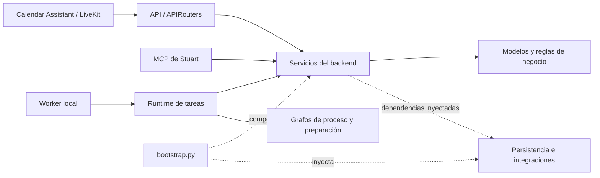

# Arquitectura local del proyecto

El repositorio contiene el backend, el agente de voz y la interfaz. La organización
se limita a código implementado. Las seis etapas son estados del proceso, no seis
carpetas de agentes por crear. Los datos y secretos conservan sus rutas originales.

## Estructura de project/

```text
project/
├── backend/
│   ├── app/
│   │   ├── main.py             # Aplicación HTTP
│   │   ├── bootstrap.py        # Composición de servicios y adaptadores
│   │   ├── worker.py           # Entrada y bucle del único worker local
│   │   ├── mcp_server.py       # Herramientas MCP sobre los servicios
│   │   ├── api/                # APIRouters y dependencias HTTP
│   │   ├── clients/            # Dominio, registro y repositorio de clientes
│   │   ├── verification/       # Servicio OTP, contratos, schemas y repositorio
│   │   ├── notifications/      # Correo OTP, adaptadores y plantilla
│   │   ├── workflow/           # Grafo principal, reglas, servicio y runtime
│   │   ├── preparation/        # Grafo de preparación, estado, nodos y servicio
│   │   ├── persistence/        # SQL del proceso, checkpoints y exclusión local
│   │   ├── integrations/       # Google, Slack, IA y proveedores ficticios
│   │   ├── core/               # Rutas y validación común
│   │   ├── cli/                # Comandos administrativos y lanzadores de demos
│   │   └── demos/              # Recorrido ficticio y UI de la demo OAuth
│   ├── fixtures/               # Datos ficticios versionados
│   └── tests/                  # Pruebas agrupadas por responsabilidad
├── agents/
│   └── 1. calendar assistant/
│       ├── src/                # Entrada, reglas, adaptadores y herramientas de voz
│       ├── prompts/
│       ├── demos/              # Runner de voz con modelo y transporte ficticios
│       ├── tests/
│       ├── agent.json
│       └── secrets/            # Estado privado existente
├── frontend/
│   ├── office-dashboard.html
│   ├── src/                    # JavaScript y CSS
│   ├── assets/                 # Recursos estáticos: SVG e imágenes
│   └── tests/
├── transcript-capture/         # Adaptación reproducible del capturador TranscripTonic
├── data/                       # Estado activo privado
├── generated/                  # Exportaciones y ejecuciones de demostración
├── secrets/                    # Credenciales privadas
└── .env                        # Configuración local única
```

Cada componente mantiene sus dependencias y pruebas. `docs/`, `references/`,
`scripts/`, `.github/`, `Makefile` e `issues.md` siguen en la raíz del repositorio.
Los entornos virtuales, caches y metadatos de instalación están ignorados en Git.

## Entradas y dependencias



Las reglas puras de clientes, agenda y transiciones del proceso no dependen de
FastAPI, MCP, LiveKit ni proveedores. Los servicios reciben sus colaboradores y
no construyen repositorios, clientes HTTP ni conexiones. Los servicios de proceso y preparación dependen de `workflow/ports.py`, que expone
estado, pausas y ejecución como datos y operaciones propios.
`integrations/langgraph.py` traduce ese contrato a `Command`, snapshots y
configuración de LangGraph. API y MCP traducen sus protocolos a llamadas a los servicios.

`bootstrap.py` es el lugar de composición: crea repositorios, proveedores y grafos,
conecta los eventos de preparación con el proceso principal y entrega el runtime.
No importa FastAPI. `api/dependencies.py` se ocupa de `Depends`, autenticación,
instancias HTTP y conversión de fallos a respuestas HTTP.

| Módulo | Responsabilidad actual |
| --- | --- |
| `clients/domain.py` | Identidad, código permanente y contrato `ClientRegistry` |
| `clients/repository.py` | Registro específico de clientes en SQLite |
| `verification/service.py` | Reglas OTP, sesiones, límites y autorizaciones, sin SQL |
| `verification/ports.py` | Contratos transaccionales de sesiones y contadores |
| `verification/repository.py` | SQLite, schema existente, migración compatible y transacciones OTP |
| `notifications/` | Plantilla OTP y adaptadores Gmail/SMTP propios de esa función |
| `api/calendar_access.py` | Rutas existentes bajo `/api/calendar-access` |
| `api/meetings.py` | Registro de reunión con verificación vigente |
| `api/webhooks.py` | Validación de identidad/firma y adaptación de eventos Google/GitHub |
| `api/workflow.py` | Consultas y eventos autenticados del proceso |
| `mcp_server.py` | Las mismas herramientas MCP y schemas, delegando decisiones al servicio |
| `workflow/service.py` | Eventos, validación de avance, trabajo medido e historial |
| `workflow/runtime.py` | Despacho, recuperación y coordinación de tareas persistidas |
| `worker.py` | Bucle, polling y mantenimiento; ningún servidor lo inicia implícitamente |
| `persistence/workflow.py` | SQL compartido de tareas, versiones, entregas, eventos y tiempos |
| `persistence/checkpoints.py` | Ciclo de vida de savers SQLite/PostgreSQL |
| `persistence/locking.py` | Exclusión del worker y error de concurrencia |
| `workflow/ports.py` | Contrato compartido de ejecución y snapshots con datos simples |
| `integrations/langgraph.py` | Único adaptador de ejecución que conoce `Command` y snapshots de LangGraph |
| `integrations/` | Adaptadores concretos y errores de proveedores |

Los repositorios específicos existentes de clientes y adaptadores OTP siguen con
su módulo propietario. La persistencia del proceso completo ya no pertenece a
preparación. No se agregan interfaces ni repositorios por tabla sin un consumidor
real. Las pruebas de arquitectura comprueban los límites de importación y prohíben
SQLite y LangGraph dentro de los servicios de negocio. El repositorio OTP conserva
`BEGIN IMMEDIATE`, commits, rollback, schema y límites; retorna diccionarios, no filas SQLite.

## Grafos LangGraph

Se usa la librería directamente con el patrón documentado
[Custom workflow](https://docs.langchain.com/oss/python/langchain/multi-agent/custom-workflow).
FastAPI emplea los mecanismos de
[Bigger Applications](https://fastapi.tiangolo.com/tutorial/bigger-applications/):
`main.py`, módulos, `APIRouter` y dependencias. La organización de cada grafo sigue
[Application structure](https://docs.langchain.com/oss/python/langgraph/application-structure)
y agrupa construcción, estado y nodos. Estos frameworks permiten adaptar los
nombres y las carpetas; la estructura conjunta es una decisión del proyecto.

`workflow/graph.py` coordina seis etapas mediante `StateGraph`, edges condicionales
e `interrupt()`. `preparation/graph.py` construye el flujo posterior a la reunión;
`state.py` y `nodes.py` están junto al grafo. El modelo se recibe mediante
`DraftGenerator`; el repositorio y la búsqueda también son inyectados.

| Etapa | Condición de avance |
| --- | --- |
| 1. Engagement Manager | Reunión verificada → transcripción utilizable → preparación → aprobación exacta |
| 2. Dirección | Aprobación expresa; el rechazo termina el proceso |
| 3. Arquitectura | Entregable versionado y aprobación expresa |
| 4. FinOps | Aprobación → ingeniería; solicitud de cambios → arquitectura |
| 5. Ingeniería | Entregable versionado y aprobación expresa → informe |
| 6. Informe | Entregable versionado y aprobación expresa → cierre |

El proceso usa `process:<case_id>` y preparación usa `preparation:<case_id>`.
Son dos grafos con estados independientes enlazados por eventos; no se convierten
en un nuevo grafo anidado durante esta reorganización. Agent Server y
`langgraph.json` no forman parte de este modo de ejecución.

Cada evento identifica etapa, iteración y versión. Se valida al encolar y al
aplicar. Una devolución incrementa la iteración e invalida aprobaciones antiguas.
El checkpoint permite recuperar sin repetir transiciones; documentos y avisos
mantienen sus claves de deduplicación. Un envío Slack incierto exige conciliación.

Las etapas 2–6 coordinan trabajo externo: todavía no implementan sus agentes ni
integran PRs. Los webhooks aportan evidencia; un issue cerrado no aprueba etapas.
El hash de un documento externo es declarado por el operador. La identidad viene
del MCP STDIO privado o del bearer HTTP configurado; el runtime sigue siendo de
un único operador, sin añadir autorización empresarial por puesto.

## Agente de voz

`project/agents/1. calendar assistant` mantiene su nombre, entrada `src/agent.py`,
identidad y modelos en `agent.json`, prompt y entorno `uv`.
`src/domain/` tiene las reglas de agenda y códigos; `src/integrations/` accede al
backend por HTTP y a Calendar; `src/tools/` conserva las herramientas MCP.
El backend no importa LiveKit y el agente no importa paquetes del backend.

El runner ficticio se ejecuta con `python -m demos.voice` desde la carpeta del
agente. Es una demostración con el SDK real y proveedores guionados, no una prueba
de comprensión del lenguaje por un modelo real. La preparación es otro agente
lógico implementado como grafo del backend y consta en el registro de agentes.
Las pruebas conservan los mocks y transcripts simulados. No hay escenarios ni
workflows de simulación cloud; las pruebas no hacen llamadas reales al agente.

La sesión de voz conserva una referencia privada de la cita y entrega un recibo
firmado después de cerrar el audio. El backend persiste la entrega y el worker
procesa la cita sin depender de la sesión OTP ya cerrada. La validación incluye
cliente habilitado, firma del servicio y correlación con el evento de Calendar.
`workflow/calendar_sync.py` coordina canales `events.watch` y sincronización
incremental; `workflow/receipts.py` valida las entregas al cierre. Se reutilizan
las tablas de reuniones, eventos, tareas y checkpoints existentes. El worker no
consulta periódicamente Calendar en modo real. Ver
[configuración y límites de la integración](calendar-integration.md).

`calendar_webhook.py` es una entrada HTTP local exclusiva para el túnel de
desarrollo, en el puerto 8001. Reutiliza el handler de Calendar, la composición y
la persistencia del backend; solo publica el callback, sin documentación ni rutas
privadas. El backend completo permanece en localhost:8000.

`transcript-capture/prepare.py` construye una extensión local desde una versión
fijada y verificada de TranscripTonic, conservando su licencia MIT. La salida y
su credencial viven en `project/generated/`, ignorado por Git. Captura subtítulos,
nombres y tiempos en Chrome y entrega el resultado al backend privado de la misma
computadora. No agrega una ruta al receptor público de Calendar.
`workflow/transcripts.py` valida la entrega y coordina su correlación con una cita,
persistencia y avance por el worker; HTTP nunca genera insumos. Las capturas
incompletas no se publican y las entregas se deduplican por ID y contenido.
Ver [operación y límites](../project/transcript-capture/README.md).

## Frontend y demostraciones

La oficina virtual sigue siendo una aplicación estática. Conserva
`office-dashboard.html`; los JS y CSS viven en `src/` y los SVG en `assets/`.
No consume todavía estados del backend. La reorganización no añade un framework
web ni un proceso de compilación.

Las demos del backend están en `app/demos/`. `app/cli/` las inicia y conserva los
comandos de administración. La autenticación/generación de la demo OAuth existente
se extrajo a `integrations/ai/oauth.py` conservando su comportamiento y pruebas.
Sigue siendo una demo separada: la reorganización no añade renovación automática
ni conecta implícitamente la suscripción al proveedor productivo de preparación.
Los mocks ejecutables están en `integrations/mocks.py`, sus datos en `fixtures/`.

## Ejecución y estado local

Una terminal por componente necesario:

```sh
make backend          # FastAPI, puerto 8000
make workflow         # Único worker; requiere WORKFLOW_ENABLED=1
make agent            # Voz
make preparation-mcp  # MCP STDIO; también disponible make mock-mcp
make frontend         # Oficina, puerto 8765
```

API y MCP comparten los servicios mediante la misma composición y nunca arrancan
workers. El bloqueo del worker se mantiene durante su ejecución y se comprueba
al procesar una tarea; funciona para el uso local macOS/Linux de este proyecto.
No constituye un bloqueo distribuido entre hosts.

`project/.env` conserva su ruta; las variables del proceso tienen precedencia.
`core/config.py` centraliza las raíces de proyecto, backend y referencias. Las
rutas OAuth de voz siguen resolviéndose desde la carpeta del agente. Ninguna base,
cliente, código, token ni secreto existente se migra o reinicia por estos cambios.

El workflow usa sus propias bases SQL y de checkpoints, distintas de la base OTP.
SQLite es el almacenamiento local; se conservan los adaptadores PostgreSQL y su
prueba opcional con URL aislada. `WORKFLOW_MODE=mock` mantiene un directorio propio.
Las bases incluidas en `generated/` son parte del paquete de una demo; sus rutas y
el puntero de demo activa se conservan. No se borran para ordenar carpetas.

Las mediciones existentes distinguen actividad humana, actividad del agente,
esperas, retrabajo y aceptación de entregas. El Process Time se registra a partir
de intervalos explícitos, no se infiere del tiempo entre issues o pausas del grafo.
La estructura no agrega infraestructura de despliegue.
