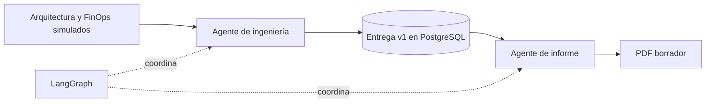

# Entrega 1: ingeniería e informe ejecutivo

Incremento local de los issues #21 y #22. No cierra sus alcances completos.



## Qué funciona

- Contrato Pydantic versionado y entrada S3 de ejemplo.
- Dos componentes de agentes de negocio implementados como nodos LangGraph:
  ingeniería comprueba coherencia, prepara Terraform y registra una entrega;
  informe consolida hechos, métricas y pendientes en un PDF.
- PostgreSQL real: entrada, entrega, tiempos, reporte y archivos con SHA-256.
- Referencia fija al commit de baselines. La aprobación continúa pendiente.
- API local para ejecutar, consultar y descargar el PDF y los archivos Terraform.
- Procesamiento repetible: la misma entrada e identificador devuelve el mismo
  resultado. Reutilizar el identificador con otra entrada devuelve HTTP 409.
- Un bloqueo PostgreSQL impide procesar simultáneamente la misma entrega.
- Cada etapa se confirma de forma atómica. Si falla el PDF, una nueva ejecución
  recupera la entrega técnica guardada sin repetir ni duplicar sus archivos.
- Migración explícita y repetible. Importar el backend no crea tablas ni servicios.

El comportamiento de este incremento es determinista y usa reglas y herramientas
Python; no llama a un modelo LLM ni consume APIs de AWS, Google u OpenAI.
LangGraph se utiliza realmente para coordinar el recorrido. La persistencia de
etapas se implementa en el repositorio PostgreSQL; no se afirma que exista un
checkpointer nativo LangGraph ni recuperación a mitad de un nodo.

## Qué es simulado y qué queda pendiente

Arquitectura, costos, aprobaciones de los insumos y tiempos de fases anteriores
son simulados y están identificados como tales. Los tiempos del recorrido local,
los archivos preparados y el PDF son reales.

La API de este incremento solo admite modo `demo`, baseline S3 pendiente y
aprobaciones de origen `simulated_approved`. Rechaza entradas que intenten
presentar esas aprobaciones como reales.

Los archivos Terraform **no se aplican**, no se comprueba aquí que KMS exista y
no se afirma que `terraform fmt/validate`, Trivy o un despliegue hayan pasado.
El bucket y el ARN KMS del ejemplo son valores ficticios. No se crea ni publica
un PR y el proyecto permanece sin aprobación y sin cierre.

Incrementos siguientes: integración con las entregas reales de #19/#20,
ejecución de validaciones técnicas y despliegue local acordado, GitHub MCP,
interfaz MCP del informe, ajustes/versiones, aprobación humana y cierre.
La descarga por API y la lectura del PDF permiten revisar este borrador; todavía
no implementan el ciclo de ajustes y aprobación del Engagement Manager.

## Preparar el entorno

Python 3.12 y PostgreSQL 16 o posterior con una base UTF-8. Las instrucciones
siguientes se ejecutan en una copia del repositorio, no sobre `main` compartido.

Desde la raíz, en PowerShell:

```powershell
python -m venv .venv
.venv\Scripts\python.exe -m pip install -r project/requirements-delivery.lock
```

El lockfile registra las versiones usadas en esta entrega, incluidas las pruebas.
Para evolucionar las dependencias, modificar primero los requirements de `app/`
y regenerar el lockfile.

Si ya existe PostgreSQL, usar una base local dedicada y configurar
`DELIVERY_DATABASE_URL`. Si se dispone de Docker, desde `project/`:

```powershell
$env:DELIVERY_POSTGRES_PASSWORD = 'elegir-una-clave-local'
docker compose -f compose.delivery.yml up -d --wait
$env:DELIVERY_DATABASE_URL = 'postgresql://delivery:' + [Uri]::EscapeDataString($env:DELIVERY_POSTGRES_PASSWORD) + '@127.0.0.1:55432/delivery'
```

La contraseña anterior es un marcador que se debe sustituir localmente.
El puerto solo se expone en loopback. También puede usarse PostgreSQL instalado
sin Docker; el código no depende del gestor que lo inicia.

## Ejecutar y exportar

Desde `project/`, con `DELIVERY_DATABASE_URL` configurada:

```powershell
..\.venv\Scripts\python.exe -m app.delivery init-db
..\.venv\Scripts\python.exe -m app.delivery run --input examples/delivery-1.json --output data/delivery-demo
```

Resultado esperado: estado `draft_ready`, JSON de la entrega, `main.tf`,
`variables.tf`, `terraform.tfvars.example` y `informe-ejecutivo-v1.pdf`.
Los archivos exportados y las credenciales locales están excluidos de Git.

Una entrada incompleta produce error de contrato. Una revisión FinOps distinta,
un presupuesto excedido o una región KMS incoherente producen estado `blocked`
y no generan un informe exitoso.

Cambiar el ejemplo requiere un `delivery_id` UUID nuevo. El identificador
representa una versión inmutable, no el nombre de una carpeta que se sobrescribe.
Reejecutar una entrega completada no vuelve a generar el PDF.

## API de demostración

Desde `project/`:

```powershell
..\.venv\Scripts\python.exe -m uvicorn app.delivery.local_app:app --host 127.0.0.1 --port 8011
```

Documentación interactiva: `http://127.0.0.1:8011/docs`.

| Operación | Ruta |
| --- | --- |
| Ejecutar | `POST /api/delivery/runs` |
| Consultar | `GET /api/delivery/runs/{delivery_id}` |
| Descargar un archivo de esa entrega | `GET /api/delivery/runs/{delivery_id}/artifacts/{artifact_id}` |

La entrada de `POST` es el contenido de `examples/delivery-1.json`. La respuesta
incluye los identificadores necesarios para descargar el PDF y sus respaldos.
Descargar un archivo con el identificador de otra entrega devuelve 404.
La API también está registrada en el backend principal; el servidor separado
permite demostrarla sin configurar calendario, correo o Azure OpenAI.

Este servidor es una demostración local sin autenticación propia. Mantenerlo en
`127.0.0.1`; la autorización por proyecto y su exposición mediante MCP forman
parte de la integración posterior.

## Contrato y métricas

`DemoRequest` define entradas tipadas y `EngineeringHandoff` la entrega v1.
`ReportDraft` relaciona cada PDF con la entrega exacta que consolidó.
Los modelos están en `app/delivery/models.py`; la API publica su esquema de entrada.

Los importes usan Decimal, moneda y periodo explícitos. El PDF separa presupuesto,
estimación y gasto real: este último figura como no disponible.

Para cada fase registrada:

- Lead Time: diferencia entre aceptación y entrega de esa fase.
- Process Time en este contrato: esfuerzo acumulado de intervalos `work` y
  `rework`, con desglose humano/agente. Con trabajo paralelo puede superar el
  tiempo transcurrido.
- Duración activa: unión de intervalos de trabajo, sin doble conteo de paralelismo.
- Espera: unión de intervalos explícitos de espera excluyendo actividad simultánea.
- Tiempo sin clasificar: parte del Lead Time sin intervalos registrados; no se
  presenta automáticamente como espera.
- Retrabajo: parte del esfuerzo marcada como `rework`.

Esta convención de PT debe acordarse con el equipo al integrar las otras fases.
No se infiere un Lead Time global del proyecto sin sus límites definidos.
Los tiempos ausentes se listan como faltantes, nunca como cero.

El PDF es una instantánea anterior a su propia finalización. Por eso su tabla
no incluye el tiempo final de renderizado; la consulta de la entrega en la API
sí incluye el intervalo real del agente de informe.

## Pruebas

Desde `project/`, usar una base PostgreSQL de pruebas con permisos para crear
esquemas. Cada prueba de integración crea y elimina exclusivamente su esquema
aleatorio `delivery_test_*`.

```powershell
$env:DELIVERY_TEST_DATABASE_URL = $env:DELIVERY_DATABASE_URL
..\.venv\Scripts\python.exe -m pytest tests/test_delivery.py -q
..\.venv\Scripts\python.exe -m pytest tests -q
..\.venv\Scripts\python.exe -m ruff check app/delivery tests/test_delivery.py
..\.venv\Scripts\python.exe -m ruff format --check app/delivery tests/test_delivery.py
```

Sin `DELIVERY_TEST_DATABASE_URL`, las pruebas PostgreSQL se omiten expresamente;
eso no acredita la integración. La CI de raíz configura PostgreSQL real y corre
la regresión del backend en Ubuntu.

Se cubren contrato, datos incompletos, procedencia simulada, métricas paralelas,
bloqueos de negocio, descarga de archivos, idempotencia, conflicto de versiones,
concurrencia y recuperación tras un fallo del PDF. El PDF de ejemplo se renderizó
y se revisaron visualmente sus dos páginas.

En Windows se reprodujeron dos fallos anteriores de Gmail relacionados con la
aserción de permisos POSIX `0600`. Se comprobaron también en una copia intacta
del commit base `ec8f2a2`. No se modificaron los módulos ni las pruebas de Gmail.

## Rama y PR

Rama local: `feat/delivery-1-engineering-report`. El primer PR propuesto reúne
este recorrido pequeño y su contrato compartido: `Refs #21`, `Refs #22`.
No debe usar palabras de cierre porque faltan integraciones y aprobaciones.
Los incrementos posteriores pueden seguir separados por issue. No se publicó
la rama ni se abrió un PR durante esta entrega.
