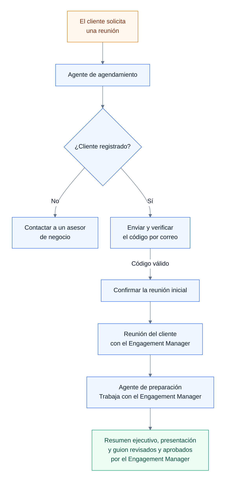
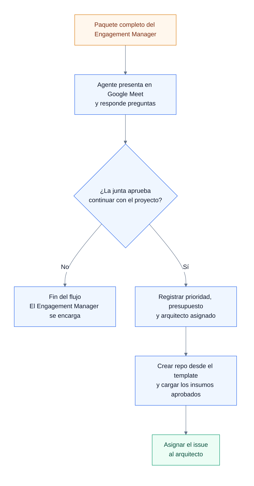
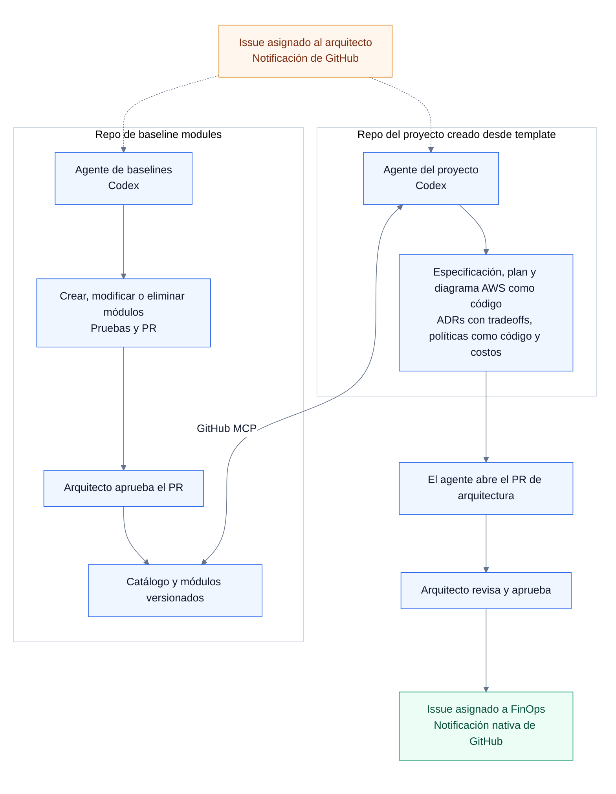
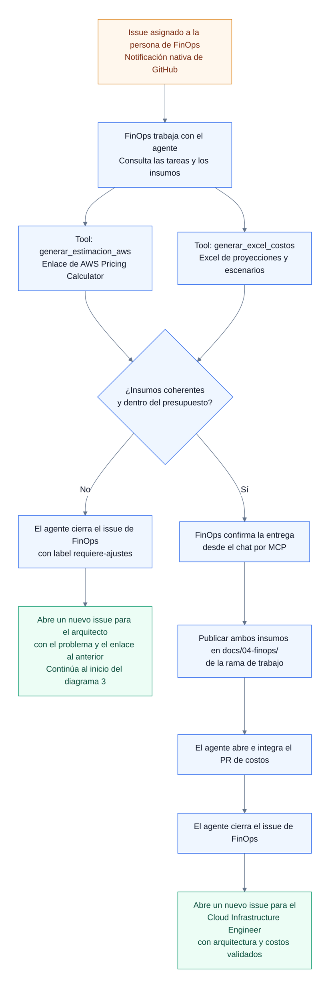
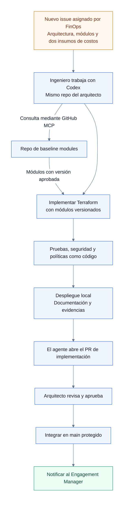
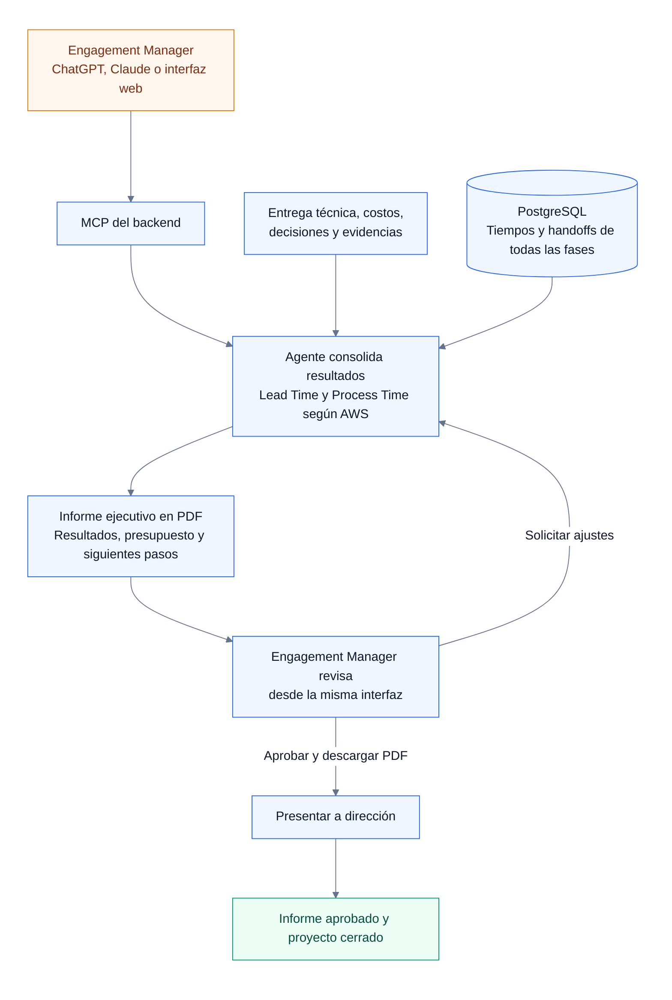

# Issues de agentes

Seis agentes del proceso orquestados por medio de **LangGraph y PostgreSQL**.

> **Nota para todos los agentes:** Registrar **Lead Time** y **Process Time** según [AWS](https://docs.aws.amazon.com/prescriptive-guidance/latest/strategy-devops-value-stream-mapping/introduction.html). Guardar las mediciones y los handoffs en PostgreSQL para la orquestación.

## 1. Engagement Manager — Agendamiento y preparación ejecutiva

**Stack recomendado:**

- **Agendamiento:** SwiftUI y LiveKit.
- **Preparación:** ChatGPT, Claude o una interfaz web con cliente MCP; GitHub para los repositorios de proyectos.
- **Orquestación y datos:** LangGraph y PostgreSQL.

**Herramientas recomendadas:** Google Calendar, Gmail API, endpoint de whitelist y MCP del histórico de proyectos.

**Entrada:**

- **Agendamiento:** solicitud del cliente, correo y disponibilidad para la reunión inicial.
- **Preparación:** transcripción y notas de la reunión, junto con antecedentes de proyectos anteriores.

**Entrega:** reunión inicial confirmada; resumen ejecutivo, presentación y guion aprobados por el Engagement Manager para presentar a dirección ejecutiva.

**Funcionalidades:**

- [ ] **Agendamiento:** verificar el registro y el código por correo, consultar disponibilidad y confirmar la reunión; gestionar cancelaciones y reprogramaciones, y remitir al asesor a quienes no estén registrados.
- [ ] **Histórico de proyectos:** consultar proyectos anteriores para recuperar antecedentes relevantes.
- [ ] **Preparación ejecutiva:** organizar la transcripción, las notas y los antecedentes; elaborar el resumen con necesidades, requisitos, presupuesto y plazos, junto con la presentación y el guion, para revisión y aprobación del Engagement Manager.

## 2. Dirección ejecutiva — Priorización

**Stack recomendado:** OpenClaw, Google Meet, LangGraph y PostgreSQL.

**Herramientas recomendadas:** GitHub y notificaciones por Gmail API o Slack.

**Entrada:** paquete completo preparado por el Engagement Manager para la reunión con dirección ejecutiva: resumen ejecutivo aprobado, transcripción, notas, antecedentes, presupuesto, plazos, presentación y guion.

**Entrega:** repo del proyecto creado desde el template, con propuesta, decisión, prioridad, presupuesto e issue de arquitectura cargados.

**Funcionalidades:**

- [ ] Presentar, responder preguntas y registrar la decisión de la junta.
- [ ] Crear el repo desde `aws-cloud-consulting-project-template`, cargar los insumos aprobados y notificar al arquitecto.

## 3. Cloud Solutions Architect — Diseño

**Stack recomendado:** Codex, LangGraph y PostgreSQL.

**Herramientas recomendadas:**

- [Agent Toolkit for AWS](https://docs.aws.amazon.com/agent-toolkit/latest/userguide/what-is-agent-toolkit.html)
- [AWS DevOps Agent](https://docs.aws.amazon.com/devopsagent/latest/userguide/working-with-devops-agent-accessing-devops-agent-index.html)
- [AWS Security Agent](https://docs.aws.amazon.com/securityagent/latest/userguide/what-is.html)

> Acceso complementario: sesiones de Codex separadas para proyecto y baselines; [GitHub MCP](https://github.com/github/github-mcp-server) para acceso directo a módulos e issues/PRs; MCP del backend para tiempos, handoffs y coordinación con LangGraph. AWS Pricing MCP, AWS MCP y Terraform MCP configurados para el puesto.

**Entrada:** issue de arquitectura en el repo del proyecto creado desde `aws-cloud-consulting-project-template`, con los insumos previos. Llega desde la aprobación del proyecto en el diagrama 2 o desde una corrección solicitada por el agente FinOps en el diagrama 4, con el problema y el enlace a la revisión que requirió ajustes.

**Entrega:** el agente de Codex cierra el issue de arquitectura y crea un nuevo issue asignado a FinOps en el mismo repo, con diseño aprobado, commit, versiones de módulos y enlaces a los issues anteriores. GitHub notifica la asignación.

**Funcionalidades:**

- [ ] Trabajar con el agente del repo del proyecto para documentar requisitos, plan, **diagrama de arquitectura AWS como código**, ADRs con tradeoffs, **políticas como código** y estimación inicial.
- [ ] Consultar directamente el catálogo, código, documentación y versiones de baselines mediante GitHub MCP para seleccionar los módulos de la arquitectura.
- [ ] Crear, modificar o eliminar módulos en `aws-cloud-consultant-baseline-modules` con su propio agente, pruebas, revisión del impacto en consumidores y PR.
- [ ] Los PRs de arquitectura y baselines requieren la aprobación del arquitecto.
- [ ] El agente de Codex abre el PR de arquitectura al terminar el diseño y solicita la revisión del arquitecto, apoyándose en las herramientas AWS habilitadas.
- [ ] Atender los issues de corrección abiertos por el agente FinOps. Actualizar los módulos y los documentos afectados, mantener coherentes el diagrama, las versiones, los supuestos y los costos, y solicitar la aprobación del arquitecto.
- [ ] Tras la aprobación del arquitecto, el agente de Codex cierra el issue atendido y crea un nuevo issue para FinOps mediante GitHub MCP, con commit, diagrama, recursos, región, supuestos, presupuesto, versiones de baselines y referencias a los issues anteriores. GitHub gestiona el aviso y LangGraph registra el handoff.

## 4. FinOps Analyst — Costos

**Stack recomendado:** tools por MCP desde ChatGPT, Claude o una interfaz web con cliente MCP; LangGraph y PostgreSQL.

FinOps aprueba los documentos desde el chat y el agente abre e integra el PR de costos. Este flujo requiere que las reglas de la rama permitan esa integración tras las comprobaciones, sin revisión del arquitecto. GitHub no permite aprobar un PR propio. [Documentación de GitHub](https://docs.github.com/en/pull-requests/how-tos/review-pull-requests/approving-a-pull-request-with-required-reviews).

**Herramientas recomendadas:**

[Agent Toolkit for AWS](https://docs.aws.amazon.com/agent-toolkit/latest/userguide/what-is-agent-toolkit.html), [AWS DevOps Agent](https://docs.aws.amazon.com/devopsagent/latest/userguide/working-with-devops-agent-accessing-devops-agent-index.html) y [AWS Security Agent](https://docs.aws.amazon.com/securityagent/latest/userguide/what-is.html).

> Acceso complementario: **GitHub MCP** para consultar tareas, comentar y publicar resultados; MCP del backend para acciones del flujo con LangGraph. AWS Pricing MCP, AWS MCP y Terraform MCP configurados para el puesto.

Tools propias por implementar y exponer por MCP:

| Tool | Resultado |
| --- | --- |
| `generar_estimacion_aws` | Automatizar la calculadora web y obtener el [enlace real de la estimación guardada](https://docs.aws.amazon.com/pricing-calculator/latest/userguide/save-share-estimate.html), con respaldo CSV/PDF. |
| `generar_excel_costos` | Crear `forecast.xlsx` con costos por recurso, fórmulas, proyecciones mensuales/anuales y escenarios. |

**Entrada:** nuevo issue asignado a FinOps con diseño aprobado o corregido, commit, módulos, recursos, región, supuestos y presupuesto. Si viene de una corrección, incluye los enlaces a la revisión anterior y al issue de arquitectura. Requiere cuenta GitHub con acceso al repo; el trabajo se realiza desde el chat.

**Entrega:**

- **Si cumple:** tras la aprobación de FinOps desde el chat, el agente abre e integra el PR de costos, cierra el issue de FinOps y crea uno nuevo en el mismo repo, asignado al **Cloud Infrastructure Engineer**, para iniciar el desarrollo. Incluye commit, PR de costos, arquitectura, enlace de AWS Pricing Calculator, Excel en `docs/04-finops/` y referencia al issue cerrado. GitHub notifica la asignación.
- **Si requiere ajustes:** el agente cierra el issue FinOps con el label `requiere-ajustes` y abre otro en el mismo repo, asignado al arquitecto, con el problema y las referencias a los insumos revisados. El flujo continúa al inicio del diagrama 3.

**Funcionalidades:**

- [ ] Consultar las tareas asignadas y trabajarlas desde ChatGPT, Claude o web mediante GitHub MCP.
- [ ] Ayudar al FinOps Analyst a redactar y publicar comentarios en el issue con dudas de arquitectura, diferencias de costos o ajustes solicitados. Mencionar al arquitecto asignado con su usuario real de GitHub (`@usuario-del-arquitecto`) e incluir referencias al diseño o a la estimación correspondiente.
- [ ] Cuando el diseño requiera cambios, el agente FinOps cierra la revisión con el label `requiere-ajustes` y crea un issue de corrección asignado al arquitecto, con el problema, los insumos afectados y el enlace al issue cerrado.
- [ ] Recibir el nuevo issue creado por Codex tras la corrección y validar el commit actualizado, regenerando la estimación y el Excel según los cambios. Mantener los enlaces entre las revisiones y las correcciones.
- [ ] Generar ambos insumos y validar supuestos, totales y presupuesto; solicitar ajustes cuando corresponda.
- [ ] Tras la aprobación de FinOps desde el chat, el agente publica los insumos y abre el PR de costos con el enlace de la estimación y el Excel. Integra el PR conforme a las reglas de la rama, cierra el issue de costos y crea uno nuevo para el Cloud Infrastructure Engineer con los entregables y el enlace al issue anterior. El backend conecta los webhooks de GitHub con LangGraph, registra estado y tiempos en PostgreSQL y evita handoffs duplicados. Los cierres con `requiere-ajustes` se registran como devoluciones y retrabajo; la fase termina al integrar los documentos aprobados por FinOps y confirmar la entrega a ingeniería.

## 5. Cloud Infrastructure Engineer — Implementación

**Stack recomendado:** Codex, Terraform, AWS Emulator, GitHub Actions, LangGraph y PostgreSQL.

**Herramientas recomendadas:**

- [AWS Emulator](https://github.com/aws/aws-emulator) y su [skill oficial `aws-emulator`](https://docs.aws.amazon.com/emulator/latest/userguide/getting-started-agent.html): entorno oficial de pruebas locales de Terraform.
- [Agent Toolkit for AWS](https://docs.aws.amazon.com/agent-toolkit/latest/userguide/what-is-agent-toolkit.html)
- [AWS DevOps Agent](https://docs.aws.amazon.com/devopsagent/latest/userguide/working-with-devops-agent-accessing-devops-agent-index.html)
- [AWS Security Agent](https://docs.aws.amazon.com/securityagent/latest/userguide/what-is.html)

> Acceso complementario: el mismo **GitHub MCP** para trabajar en el repo del proyecto y leer `aws-cloud-consultant-baseline-modules`. AWS Pricing MCP, AWS MCP y Terraform MCP configurados para el puesto.

**Entrada:** nuevo issue creado por el agente FinOps en el mismo repo del proyecto donde trabajó el arquitecto, con rama/commit, requisitos, diseño, módulos, enlace de AWS Pricing Calculator y Excel de costos validados; entorno y accesos preparados.

**Entrega:** PR abierto por el agente de Codex en el mismo repo con los cambios de ingeniería, documentación, pruebas y evidencias locales, para revisión y aprobación del arquitecto. Los documentos de FinOps ya están integrados y se referencian desde la implementación.

**Funcionalidades:**

- [ ] Implementar la infraestructura con Codex en el repo del proyecto, a partir del diseño aprobado.
- [ ] Consultar baselines por GitHub MCP y reutilizar módulos aprobados y versionados. Antes de implementar, Codex revisa con `aws-emulator` la compatibilidad de servicios AWS y módulos Terraform, y la confirma con pruebas reales en el emulador.
- [ ] Automatizar `terraform fmt`, `validate`, `plan`, `apply` y `destroy`, pruebas de integración, análisis de seguridad y políticas como código. Ejecutar las pruebas de integración con AWS Emulator localmente y en GitHub Actions, sin credenciales reales ni costos de infraestructura AWS; asegurar la limpieza incluso ante fallos.
- [ ] Mantener un catálogo versionado de servicios y recursos Terraform probados, con versiones, éxitos, errores y limitaciones. Guardar evidencias, resultados, Lead Time y Process Time mediante LangGraph/PostgreSQL.
- [ ] El agente de Codex abre el PR de implementación al terminar las pruebas, con documentación, evidencias y referencias a los insumos de FinOps, y solicita la revisión y aprobación obligatoria del Cloud Solutions Architect.
- [ ] Notificar al Engagement Manager cuando el PR esté aprobado.

> Distinguir errores de Terraform de limitaciones del emulador. Las pruebas exitosas no garantizan compatibilidad completa con AWS real ni validan sus controles de seguridad; los análisis de seguridad y políticas se ejecutan por separado.

## 6. Engagement Manager — Informe ejecutivo

**Stack recomendado:** ChatGPT, Claude o interfaz web con cliente MCP; LangGraph y PostgreSQL.

**Herramientas recomendadas:** MCP propio con tools para consultar métricas, generar PDF y registrar aprobación; GitHub MCP para consultar entregables; Gmail API o Slack para notificaciones.

**Entrada:** entrega técnica, costos, decisiones, evidencias y tiempos de todas las fases.

**Entrega:** informe ejecutivo aprobado para dirección, descargable en PDF desde la interfaz, con documentos de respaldo.

**Funcionalidades:**

- [ ] Solicitar y revisar el informe desde ChatGPT, Claude o una interfaz web por MCP, sin usar GitHub.
- [ ] Consolidar Lead Time, Process Time, esperas y retrabajo, separando actividad humana y de agentes.
- [ ] Usar una librería de Python, como ReportLab, para generar informes PDF con formato corporativo estándar para Executive Leadership, con resultados, presupuesto, pruebas locales y siguientes pasos para la aplicación.
- [ ] Permitir ajustes y aprobación del Engagement Manager desde la misma interfaz; presentar a dirección y cerrar el proyecto.
