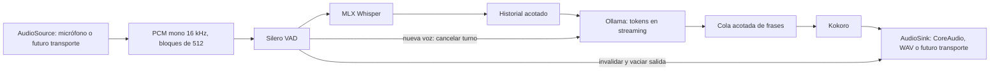

# Agente de conversación por voz local

La base prioritaria para la conversación local es ahora el [prototipo sobre Hugging Face Speech-to-Speech](../hf_speech_to_speech/README.md). Esta implementación anterior se conserva como referencia y usa un entorno independiente.

Prototipo en español para un Mac M3 Pro con 18 GB de memoria unificada. El motor recibe y emite audio mediante interfaces independientes de CoreAudio; no depende de la API de la consultora ni de sus credenciales.

| Función | Implementación predeterminada |
| --- | --- |
| Detección de voz y fin de turno | Silero VAD, ONNX CPU, bloques de 512 muestras a 16 kHz |
| Transcripción | MLX Whisper Small, español, Apple Metal |
| Respuesta con contexto | Ollama, `qwen3:1.7b-q4_K_M`, sin razonamiento extendido |
| Voz | Kokoro 82M, `ef_dora`, español, CPU con 4 hilos |
| Dispositivos locales | sounddevice / PortAudio / CoreAudio |
| Pruebas sin micrófono | WAV de entrada y salida, con el mismo motor y VAD |

## Preparación con Homebrew

Desde la raíz del repositorio:

```sh
cd project/voice_call_agent
bash scripts/setup.sh
```

El script instala las fórmulas del `Brewfile`, crea `.venv` con Python 3.12 ARM64 y las versiones de `uv.lock`, inicia Ollama mediante Homebrew, descarga Qwen y prepara Whisper/Kokoro. Homebrew ya debe estar instalado. Python 3.14 del sistema no se modifica.

La primera preparación descarga paquetes y modelos desde sus distribuidores. Después, la inferencia se realiza en este Mac y el único endpoint del motor es Ollama en loopback. `prepare` no abre el micrófono ni reproduce sonido.

Para repetir únicamente los pasos necesarios:

```sh
uv sync --frozen --extra dev --python /opt/homebrew/opt/python@3.12/bin/python3.12
brew services start ollama
ollama pull qwen3:1.7b-q4_K_M
uv run --frozen voice-call prepare
uv run --frozen voice-call doctor --json
```

Ollama mantiene el modelo cargado hasta cinco minutos después de una solicitud. `ollama stop qwen3:1.7b-q4_K_M` libera ese modelo; `brew services stop ollama` detiene el servicio de Homebrew.

Kokoro utiliza explícitamente la biblioteca **y los datos** de eSpeak NG instalados por Homebrew. Esto evita depender de las rutas de compilación de la copia incluida en `espeakng-loader`.

## Conversar

El modo `auto` detecta la salida al iniciar: con auriculares permite interrumpir hablando; con altavoces escucha por turnos para que su propia voz no cancele la respuesta. Durante la reproducción y 350 ms después, descarta la entrada del micrófono y reinicia el VAD antes de volver a escuchar. Es una protección contra la realimentación, no cancelación de eco acústico.

```sh
uv run --frozen voice-call devices
uv run --frozen voice-call chat
```

Al iniciar `chat`, macOS puede solicitar permiso de micrófono para la terminal o el IDE. Habla en español y deja una pausa breve para cerrar el turno. Con auriculares, vuelve a hablar para interrumpir; con altavoces, pulsa **Enter** para cortar la respuesta y luego habla. Enter está disponible en terminales interactivas. `Ctrl+C` detiene la captura, cancela la respuesta y guarda el resumen de métricas.

Selecciona dispositivos por los índices que devuelve `devices`:

```sh
uv run --frozen voice-call chat --input-device 0 --output-device 1
```

Para un auricular USB cuyo nombre no sea reconocido automáticamente, usa `chat --barge-in-mode on`; `off` conserva la escucha por turnos. La selección también se configura con `audio.barge_in_mode` (`auto`, `on`, `off`) y `audio.echo_tail_ms`. Al iniciar se muestran la salida y el modo elegido, y quedan registrados como un evento `audio_route`.

Una vez preparados los modelos también se puede impedir que Hugging Face y uv consulten la red:

```sh
HF_HUB_OFFLINE=1 uv run --offline --frozen voice-call chat
```

`config.toml` controla modelos, voz, contexto, dispositivos y sensibilidad del VAD. La opción global `--config otra-configuracion.toml` va antes del subcomando. Los valores predeterminados mantienen una sola sesión, contexto de 4096 tokens, hasta 160 tokens de respuesta y un historial limitado a seis turnos y 6000 caracteres. El límite de caracteres es una aproximación; el límite de contexto del modelo lo impone Ollama.

## Contexto e interrupciones

La captura continúa mientras se transcribe, se generan tokens y se reproduce la respuesta. Con auriculares, el VAD también permanece activo durante la reproducción; en modo altavoces se protege ese tramo para evitar falsas interrupciones. El VAD confirma el inicio de voz tras 96 ms y cierra el turno tras 480 ms de silencio. Mantiene 160 ms de audio previo, exige al menos 256 ms de voz y limita una intervención a 20 segundos; todos estos parámetros son configurables.

Una nueva intervención invalida el turno anterior, cierra su solicitud de generación y vacía la reproducción pendiente. Los tokens y fragmentos de voz llevan un identificador de turno para descartar resultados obsoletos. El texto se sintetiza por frases con una cola de dos elementos: no es necesario esperar la respuesta completa para empezar a hablar.

Whisper y Kokoro utilizan ejecutores independientes, cada uno con un único trabajador. Una inferencia nativa en curso no se puede matar desde `asyncio`: termina su fragmento, pero su salida se descarta si el turno fue cancelado. El siguiente trabajo del mismo modelo espera, evitando inferencias concurrentes y crecimiento ilimitado de memoria.

El historial conserva las intervenciones del usuario y las frases de respuesta cuya reproducción se completó. Si hubo audio parcial, añade una marca de interrupción; no considera escuchado el resto del texto generado. El audio ya enviado al dispositivo no se puede retirar: el corte físico está sujeto al búfer y a la latencia de CoreAudio.

## Medir sin abrir el micrófono

```sh
# Dos intervenciones sintéticas: presentación y pregunta sobre el contexto anterior.
uv run --frozen voice-call benchmark

# Interrumpir la primera respuesta con la segunda intervención, sin dispositivos reales.
uv run --frozen voice-call benchmark --barge-in

# Audio real pregrabado; se puede repetir --input para conservar contexto entre archivos.
uv run --frozen voice-call benchmark --input /ruta/pregunta.wav

# Frases propias, generadas por Kokoro y procesadas por VAD → Whisper → Qwen → Kokoro.
uv run --frozen voice-call benchmark \
  --prompt 'Me llamo Ana y estamos diseñando una aplicación de reservas.' \
  --prompt '¿Cuál es mi nombre y qué aplicación estamos diseñando?'

uv run --frozen voice-call report outputs/ID_DE_SESION
```

La entrada WAV se reproduce internamente a velocidad real para que el fin del habla tenga una referencia temporal válida. La salida se escribe en `assistant.wav`, sin reproducirla por los altavoces. `--barge-in` inicia el segundo WAV después de que empiece la respuesta, escribe la salida a velocidad real y verifica que se produzca una interrupción; requiere exactamente dos entradas. La prueba predeterminada también comprueba que la segunda respuesta recupere el nombre y el proyecto de la primera intervención. Las frases sintéticas prueban la conexión de los modelos y el contexto; no sustituyen una evaluación con distintas voces humanas, ruido e interrupciones reales.

Cada sesión guarda en `outputs/`, excluido de Git:

- `turns.jsonl`: tiempos de endpoint, STT, primer token, generación, primer fragmento TTS, primera salida de audio y estado de cada turno.
- `events.jsonl`: preparación, interrupciones y pérdidas de continuidad de entrada; sin transcripciones.
- `memory.jsonl`: muestras periódicas de memoria del proceso, Ollama y el sistema.
- `summary.json`: conteos, percentiles de latencia y picos de memoria.
- En `benchmark`, los WAV de prueba y la respuesta generada. `chat` no guarda audio ni transcripciones.

`first_audio_ms` mide desde la última muestra clasificada como voz hasta la primera salida. Incluye el silencio de cierre del VAD y el procesamiento. En `chat`, el inicio se estima con el instante DAC programado por CoreAudio; no es una medición acústica con loopback. En `benchmark`, representa disponibilidad del audio en el archivo, **no** sonido audible. La carga inicial de modelos se registra aparte en el evento `warmup`.

La memoria se informa por separado: RSS de Python, suma de RSS de los procesos Ollama, asignación del modelo/Metal reportada por `/api/ps`, pico del asignador de MLX, memoria disponible y swap del sistema. No deben sumarse todas esas cifras: en Apple Silicon hay memoria compartida y medidas que se solapan. La muestra periódica de 0,5 s puede omitir picos muy breves. La memoria global incluye las demás aplicaciones del Mac.

## Separación para futuras llamadas



`contracts.py` define `AudioSource`, `AudioSink`, `Transcriber`, `LanguageModel` y `Synthesizer`. `ConversationEngine` no importa sounddevice ni conoce dispositivos, reuniones o plataformas.

Para conectar un transporte de Google Meet o Slack Huddles:

1. El adaptador de entrada entrega `AudioFrame`: 512 muestras mono `float32` a 16 kHz y un timestamp monotónico del primer sample. Debe hacer la conversión de frecuencia con estado y marcar `discontinuity=True` si pierde audio.
2. El adaptador de salida recibe `AudioChunk`, normalmente a 24 kHz, y un `TurnToken`. Debe comprobar su cancelación, vaciar su cola en `interrupt()` y devolver `Playback` cuando termine.
3. `on_start` informa el inicio efectivo o programado de la salida. Su definición debe acompañar las métricas para comparar transportes.
4. La integración debe separar la voz remota de la salida del agente y gestionar eco, permisos y cierre de la llamada.

El prototipo **no se conecta todavía a Meet ni a Huddles**. Hará falta implementar su transporte de medios o el enrutamiento mediante dispositivos virtuales según las posibilidades de cada plataforma; aquí queda definido el límite de integración, sin asumir una API de audio disponible.

## Verificación

```sh
uv run --frozen pytest -q
uv run --frozen ruff check src tests
uv run --frozen ruff format --check src tests
```

Las pruebas de control no descargan modelos ni requieren micrófono: cubren el inicio de voz, pre-roll, cierre por silencio, límites de contexto, corte durante reproducción, descarte de audio antiguo y conservación de lo realmente reproducido. `benchmark` añade la prueba con los cuatro modelos reales y genera las métricas de esta máquina.

Los [resultados medidos en el M3 Pro de 18 GB](BENCHMARK.md) documentan el alcance y las limitaciones de la prueba inicial.

Fuentes técnicas: [Silero VAD](https://github.com/snakers4/silero-vad), [MLX Whisper](https://github.com/ml-explore/mlx-examples/tree/main/whisper), [API de chat de Ollama](https://docs.ollama.com/api/chat), [Qwen3 cuantizado](https://ollama.com/library/qwen3:1.7b-q4_K_M), [Kokoro](https://github.com/hexgrad/kokoro) y [voces españolas](https://huggingface.co/hexgrad/Kokoro-82M/blob/main/VOICES.md).
